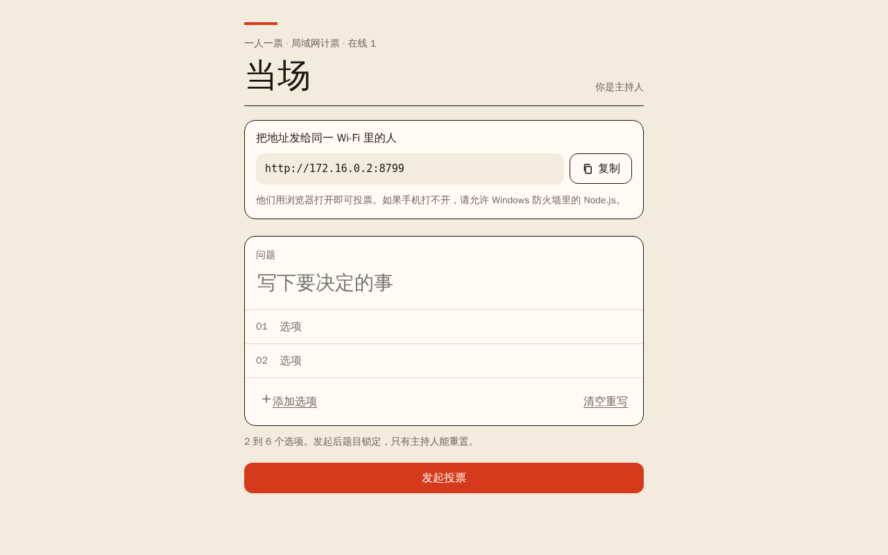
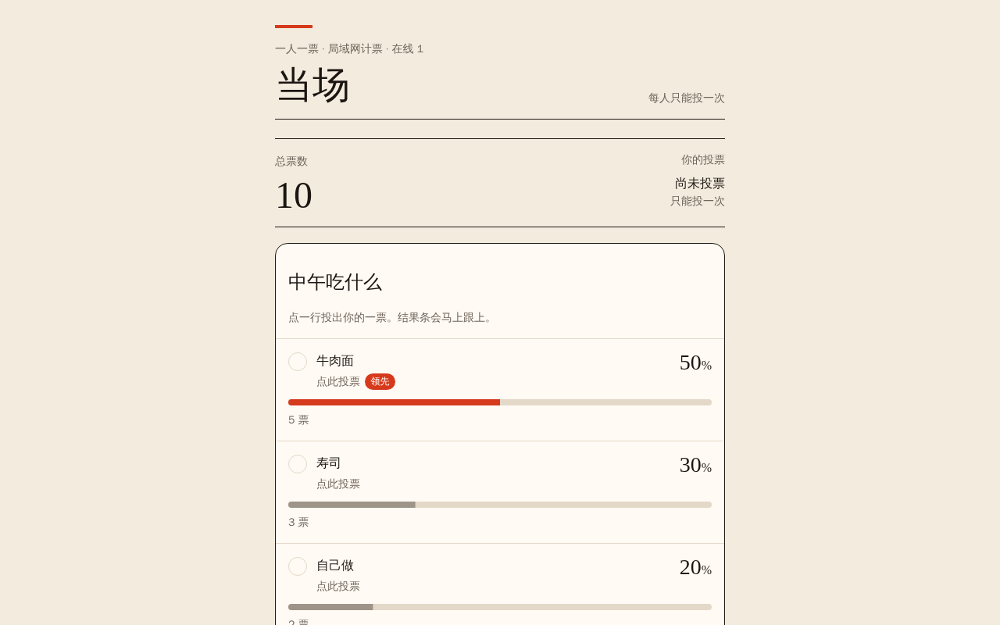

**English** | [简体中文](README.md)

# Dangchang · LAN Vote

> Start it on one Windows PC, and phones or computers on the same Wi-Fi vote in the browser — no app to install, no internet required, one vote per device, live results.





## Features

| Capability | Description |
|---|---|
| Zero install | The portable package bundles the Node.js 22 runtime; unzip and double-click `启动当场.bat` |
| Host creates polls | A question (up to 48 characters) and 2–6 options (up to 28 characters each); start a new poll at any time |
| One vote per device | Each browser generates a local voter ID; the server records it and rejects duplicate votes |
| Live results | Server-Sent Events push updates so every open page refreshes together |
| Percentages | Largest-remainder rounding guarantees the displayed percentages add up to exactly 100% |
| Host-only controls | Only the host link with the random key can reset votes or start a new poll |
| Persistence | Poll and host key are stored in `data/`, surviving restarts |
| LAN discovery | Lists the machine's IPv4 addresses; if the port is busy it automatically retries the next one |

## Download and usage

1. Download `Dangchang-LAN-Vote-v1.0-windows.zip` from [Releases](https://github.com/user-henry/lan-vote/releases)
2. Extract it anywhere
3. Double-click `启动当场.bat`
4. The host page opens in your browser; share the `http://192.168.x.x:8787` address printed in the console with people on the same Wi-Fi
5. Close the console window to stop voting

> If Windows Firewall prompts on first run, allow Node.js on **private networks**.

If a phone cannot open the page:

- Make sure both devices are on the same Wi-Fi and "guest network isolation" is disabled;
- Check that Windows Firewall allows Node.js;
- Try running as administrator or on a backup network.

## Data and privacy

| File | Content |
|---|---|
| `data/poll.json` | Current question, options, vote counts and voters |
| `data/host-key.txt` | Host key (delete it and a new key is generated on next start, invalidating old host links) |

Everything stays inside this folder on your computer and is **never uploaded to the internet**.

## Running from source

```bash
npm install
npm run dev     # TanStack Start dev server (web version)
npm run build   # build the web version
```

The Windows portable package lives in `windows/当场局域网投票/`:

| File | Purpose |
|---|---|
| `server.mjs` | LAN HTTP server + SSE push + voting API |
| `public/` | Frontend (vanilla HTML / CSS / JS) |
| `node.exe` | Node.js 22 runtime (shipped in the release zip; not committed to the source repository) |
| `启动当场.bat`, `使用说明.txt` | Launcher and usage notes |

To build the package yourself, zip the whole `windows/当场局域网投票/` directory — just keep `node.exe` and `server.mjs` side by side.

## Project structure

```text
当场局域网投票/
├── windows/当场局域网投票/   # Windows portable package (release artifact)
├── src/                       # TanStack Start web version
├── public/                    # Web static assets
├── server/                    # Web server middleware
├── scripts/                   # Build and check scripts
├── migrations/                # Web database migrations
├── screenshots/               # UI screenshots
└── package.json
```

## License

No license declared.
