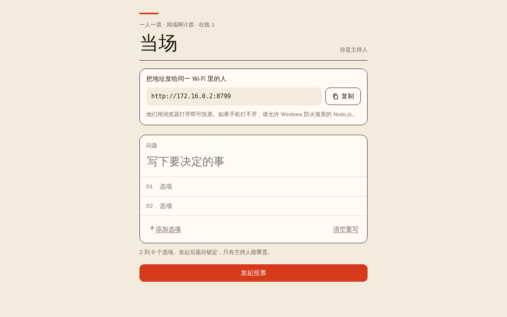
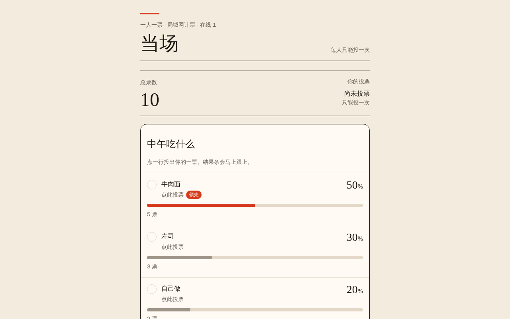

**简体中文** | [English](README.en.md)

# 当场 · 局域网投票

> 在一台 Windows 电脑上启动，同一个 Wi-Fi 下的手机和电脑用浏览器投票——不用安装 App、不用连外网、一人一票、票数实时跳动。





## 功能

| 能力 | 说明 |
|---|---|
| 零安装 | 便携包自带 Node.js 22 运行时，解压后双击 `启动当场.bat` 即可 |
| 主持人建票 | 问题最多 48 字，2–6 个选项（每项最多 28 字），可随时发起新投票 |
| 一人一票 | 每台设备由浏览器生成本地 ID，服务端记录已投用户，重复投票会被拒绝 |
| 实时票数 | 通过 SSE（Server-Sent Events）推送，所有页面同步刷新 |
| 百分比 | 最大余数法取整，保证各项百分比合计正好 100% |
| 主持权限 | 只有主持链接里带随机密钥的人能重置票数或发起新投票 |
| 断点续用 | 投票内容和主持密钥保存在 `data/`，关闭后再打开不丢 |
| 局域网地址 | 自动列出本机 IPv4 地址；端口被占用时自动 +1 重试 |

## 下载与使用

1. 从 [Releases](https://github.com/user-henry/lan-vote/releases) 下载 `Dangchang-LAN-Vote-v1.0-windows.zip`
2. 解压到任意目录
3. 双击 `启动当场.bat`
4. 浏览器会自动打开主持页；把黑色窗口里显示的 `http://192.168.x.x:8787` 发给同一 Wi-Fi 下的同学
5. 关闭黑色窗口即停止投票

> 首次运行如果 Windows 防火墙弹窗，请允许 Node.js 访问**专用网络**。

如果手机打不开：

- 确认手机和电脑连的是同一个 Wi-Fi，且没有开启"访客网络隔离"；
- 检查 Windows 防火墙是否放行了 Node.js；
- 以管理员身份运行一次，或临时关闭备用网络。

## 数据与隐私

| 文件 | 内容 |
|---|---|
| `data/poll.json` | 当前问题、选项、票数与已投设备 |
| `data/host-key.txt` | 主持密钥（删除后下次启动会重新生成，旧主持链接失效） |

所有数据只保存在这台电脑的文件夹里，**不会上传到互联网**。

## 从源码运行

```bash
npm install
npm run dev     # TanStack Start 开发服务器（浏览器版）
npm run build   # 构建 Web 版本
```

Windows 便携包位于 `windows/当场局域网投票/`：

| 文件 | 作用 |
|---|---|
| `server.mjs` | 局域网 HTTP 服务 + SSE 推送 + 投票接口 |
| `public/` | 前端页面（原生 HTML / CSS / JS） |
| `node.exe` | Node.js 22 运行时（随 Release 的 zip 分发，源码仓库不提交这个 86 MB 二进制） |
| `启动当场.bat`、`使用说明.txt` | 启动脚本与使用说明 |

自行打包：把 `windows/当场局域网投票/` 整个目录压成 zip 即可；只要 `node.exe` 与 `server.mjs` 在同级目录。

## 项目结构

```text
当场局域网投票/
├── windows/当场局域网投票/   # Windows 便携包（发布用）
├── src/                       # TanStack Start Web 版本源码
├── public/                    # Web 版本静态资源
├── server/                    # Web 版本服务端中间件
├── scripts/                   # 构建与检查脚本
├── migrations/                # Web 版本的数据库迁移
├── screenshots/               # 界面截图
└── package.json
```

## 许可

未宣告许可证。
